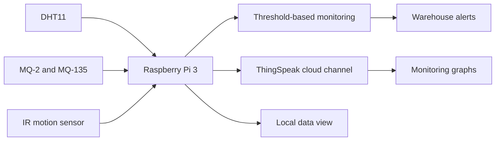
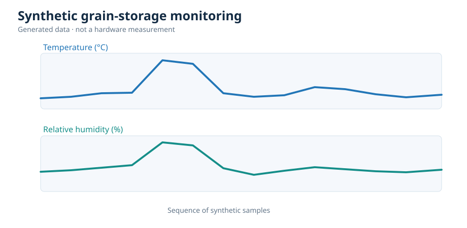

# Intelligent Grain Storage Management System

A Raspberry Pi and IoT project for monitoring environmental conditions inside grain warehouses. It follows my academic project report, which described a Raspberry Pi 3 connected to temperature, humidity, smoke/gas and movement sensors, with ThingSpeak monitoring and alerts for the warehouse operator.

The original project addressed a practical storage problem: unfavorable temperature, humidity, smoke and unauthorized movement can go unnoticed when a warehouse is inspected only manually.

## Project design

| Component | Role in the report |
|---|---|
| Raspberry Pi 3 | Reads and processes sensor information |
| DHT11 | Temperature and relative humidity |
| MQ-2 | Smoke/gas detection signal |
| MQ-135 | Air-quality/gas detection signal |
| IR sensor | Movement or unauthorized activity |
| ThingSpeak | Remote sensor data and graphical monitoring |
| Buzzer and GSM modem | Local alert and proposed remote notification |
| Desktop and Android interfaces | Local display and proposed mobile monitoring |



## Code in this repository

This repository includes an updated Python **simulation** of the project and an optional **Raspberry Pi sensor-reading example**. The simulation runs without hardware so the data flow, rules, alerts and charts are easy to test. It also includes:

- sensor readings for temperature, humidity, MQ-2, MQ-135 and IR motion;
- threshold-based alert events;
- local SQLite storage and a browser dashboard;
- ThingSpeak field formatting and optional upload to a channel you control;
- automated tests and sample charts.

The browser dashboard and local SQLite database are additions to this portfolio version. The report proposed desktop and Android monitoring; **a native Android app, live GSM alerts and automatic warehouse controls are not implemented here**. The Raspberry Pi example has not been tested on physical hardware.

### Quick start — no hardware required

Python 3.10 or newer:

```bash
python -m pip install -e .
python -m grain_monitor simulate
python -m grain_monitor dashboard
```

Open **http://127.0.0.1:8765** to view the monitoring dashboard.

Run automated tests:

```bash
python -m unittest discover -s tests -v
```

### ThingSpeak

The original report used ThingSpeak to visualize sensor measurements. The following command shows the corresponding fields without connecting to the internet:

```bash
python -m grain_monitor mock-cloud
```

Uploading is optional and requires your **own** ThingSpeak channel and an explicit command:

```bash
# Set THINGSPEAK_WRITE_KEY in your terminal environment first.
python -m grain_monitor publish --send
```

Do not commit actual API keys. The historical report included a ThingSpeak key, which is intentionally omitted here; revoke or replace that key if it remains active. The upload code has no end-to-end cloud validation in this environment.

### Raspberry Pi hardware example

See [hardware/README.md](hardware/README.md) for a sample DHT11, MQ-2, MQ-135 and IR sensor interface. A Raspberry Pi has **no native analog input**; the example uses an external MCP3008 ADC for the analog MQ sensors. Verify power and logic levels before making electrical connections.

### Example monitoring output



These plots come from generated measurements; they are **not** readings taken during the original university project. MQ gas values are uncalibrated raw signal indices, not verified CO₂ concentrations or certified fire alerts. All alert thresholds are illustrative.

## Project files

```text
src/grain_monitor/       Monitoring rules, simulation, storage and ThingSpeak interface
hardware/                Optional Raspberry Pi sensor-reading example
web/                     Local monitoring dashboard
examples/                Example generated readings and alerts
assets/                  Example monitoring chart
tests/                   Automated tests
docs/                    Project background and hardware limitations
```

## Project background

The design and component choices are based on my **Intelligent Grain Storage Management System** academic report. This repository keeps the same monitoring concept while updating the programming examples to current Python and adding tests. The report PDF and original API credential are not redistributed.

This is an educational monitoring project, not a certified fire alarm, a calibrated gas measurement device or a guarantee of grain safety. The source code in this repository is released under the MIT license.
